# Camera驱动概述

相机系统对外向用户提供预览、拍照以及录像等功能。内部简单可分为3层：应用层（app&amp;service）、相机驱动框架模型（CDDM）、硬件层（isp&amp;sensor），本次要介绍的对象为相机驱动框架模型。

OpenHarmony作为一个跨平台的操作系统，Camera子系统的目标是支持L2级别设备，框架可剪裁，可兼容L1级设备，并具备良好扩展性，可扩展到L3~L4级别设备。为了保持对多个设备制造商和图像信号处理器（ISP，或者Camera Sensor）供应商之间的跨平台兼容性，Camera采用虚拟流水线模块，并没有直接对应任何真实的ISP。但是，它与真实的处理流水线很相似，以便你能够高效地将它映射到你的硬件。Camera子系统为camera流水线上各个组件的实现提供了接口，它将CameraService与底层的camera驱动、camera硬件模块连接起来，向上屏蔽底层差异，向下传递上层应用的请求。应用通过调用硬件抽象层提供的接口来控制camera硬件以实现特定功能。

# Camera驱动框架介绍

相机驱动框架模型对上实现相机HDI接口，对下实现相机Pipeline模型，管理相机各个硬件设备。

各层的基本概念如下：

- HDI实现层: 对上实现HOS相机标准南向接口。
- 框架层: 对接HDI实现层的控制、流的转发，实现数据通路的搭建、管理相机各个硬件设备等功能。
- 适配层: 屏蔽底层芯片和OS差异，支持多平台适配。

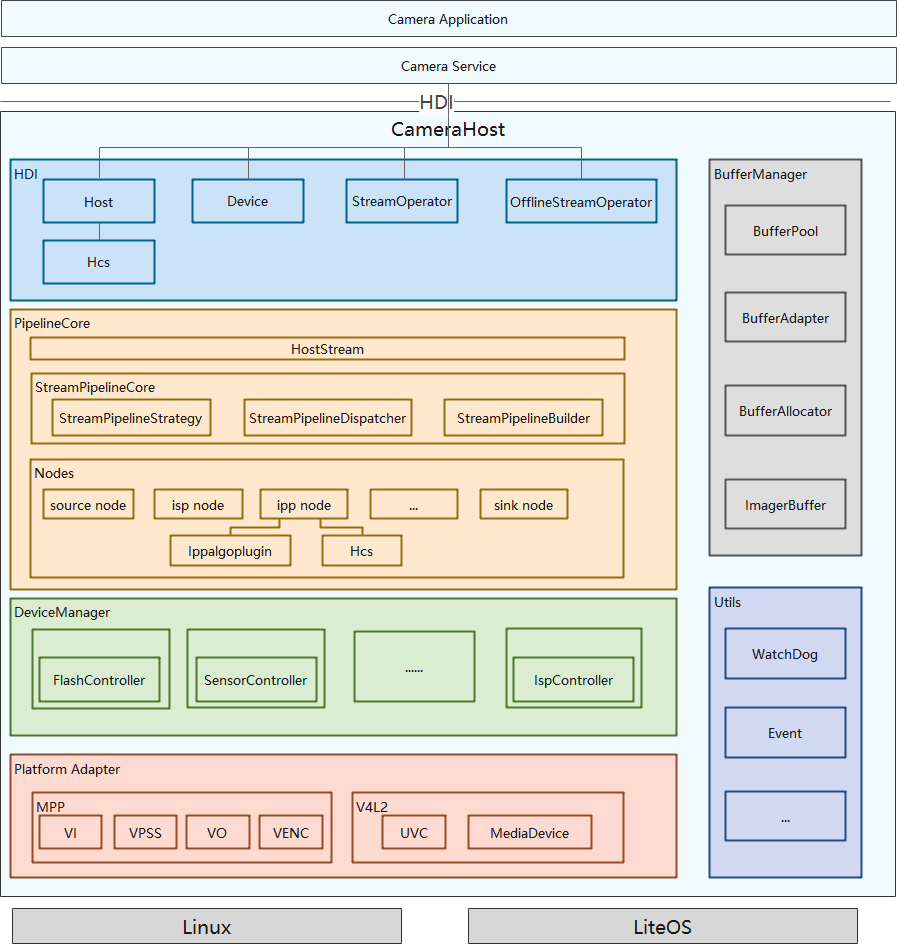

图1 Camera驱动框架模型

如图1所示，驱动框架主要由HDI、PipelineCore、DeviceManager、Platform Adapter、BufferManager以及Utils六个部分组成。

## HDI

HDI向上用于实现HDI接口，向下调用平台层的接口，完成HDI接口任务的转发。

## PipelineCore

PipelineCore向上提供接口给HDI实现层，往下调度节点的各个接口完成当前业务功能。其本身依赖hcs等配置文件，解析Pipeline的连接情况，参数设置等，负责pipeline 创建、动态修改、销毁，同时支持按一定顺序调度pipeline上各个节点，如节点的开始、配置、结束等接口。

## DeviceManager

DeviceManager模块通过调用底层硬件适配层接口，其完成底层设备树的创建和管理（通过枚举方式或者静态配置方式），向上提供底层设备能力查询以及UVC-Camera监听和上报的接口，向下传递上层控制指令和参数。为第三方芯片厂商提供统一的硬件通路接口，方便第三方芯片厂商通过适配标准接口参数和增加上层适配代码，实现三方芯片特有的功能。

## PlatformAdapter

PlatformAdapter模块主要负责适配不同平台，向上屏蔽平台差异。

## BufferManager

BufferManager主要有三部分功能：

（1）屏蔽不同内存管理的差异，为本子系统提供统一的操作接口。兼容多种内存形式，如GBM/ION，同时支持从系统heap申请内存等。

（2）子系统内部提供统一的buffer类，屏蔽GBM buffer，ION buffer等，为子系统提供统一的buffer申请/释放等接口。

（3）pipeline在运转时最关键的是buffer轮转，为了统一管理，BufferManager提供bufferpool并保证bufferpool中的buffer正常轮转，同时提供buffer轮转的监控功能。

## Utils

Utils模块提供框架所需的工具文件。

# Camera驱动框架适配指导

## Camera驱动框架配置

Hi3516DV300 配置文件路径：/vendor/hisilicon/Hi3516DV300/hdf\_config/uhdf/device\_info.hcs 。说明：其他平台可参考Hi3516DV300适配。

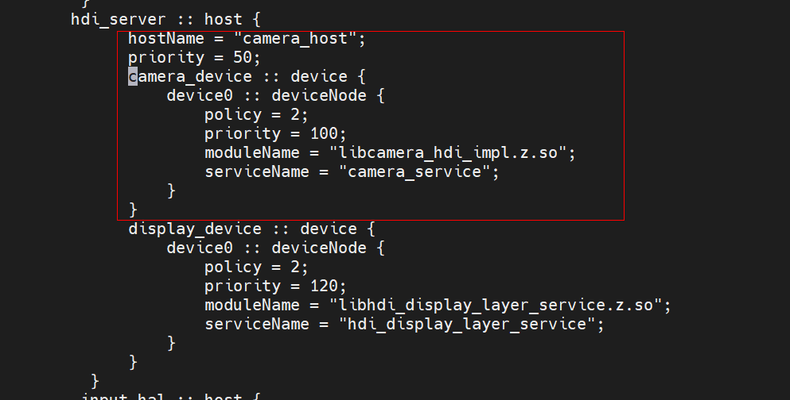

参数说明：

- host: 一个host节点即为一个独立进程，如果需要独立进程，新增属于自己的host节点
- policy: 服务发布策略，HDI服务请设置为 **2**。
- moduleName: 驱动实现库名。
- serviceName: 服务名称，请保持全局唯一性。

## Camera配置信息

1）Camera模块内部，所有配置文件使用系统支持的HCS类型的配置文件，HCS类型的配置文件，在编译时，会转成HCB文件，最终烧录到开发板里的配置文件即为HCB格式，代码中通过HCS解析接口解析HCB文件，获取配置文件中的信息。在camera.gni中通过 product\_company和device\_name参数实现不平台分开编译。

2）下图以3516平台为例，通过调用build\_hcs.py脚本，将sources中配置的hcs文件，转为outputs中配置的hcb文件。

device/hisilicon/hi3516dv300/camera/BUILD.gn

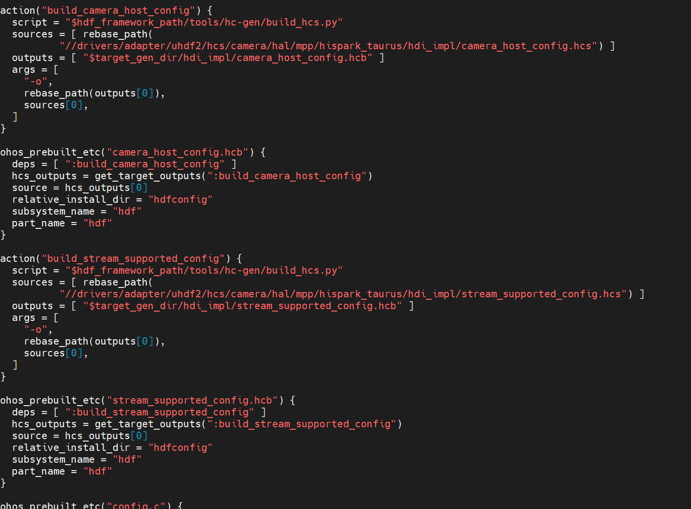

# camera驱动模块适配指导

## 框架适配介绍

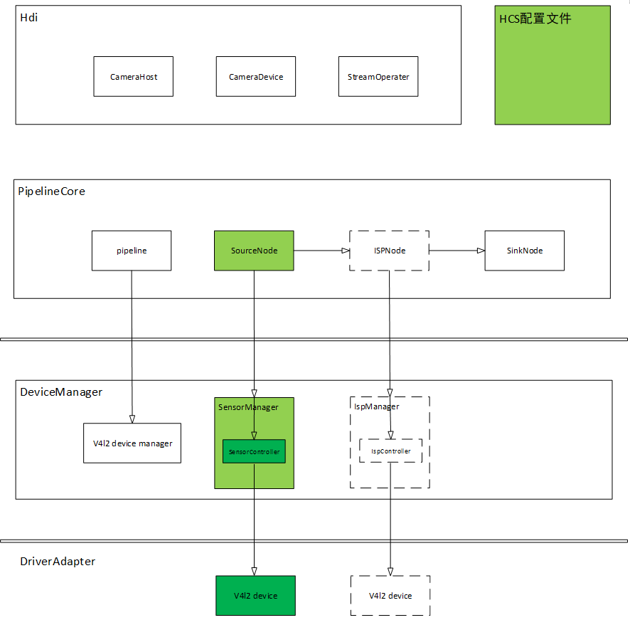

1.以v4l2为例，pipeline的连接方式是在HCS配置文件中配置连接，数据源我们称之为 SourceNode，主要包括硬件设备的控制、数据流的轮转等。ISPNode可根据需要确定是否添加此Node，因为在很多操作上其都可以和SensorNode统一为SourceNode。SinkNode 为pipeline中数据传输的终点，到此处会将数据传输回buffer queue中。

2.pipeline中的node是硬件/软件模块的抽象，所以对于其中硬件模块node，是需要向下控制硬件模块的，在控制硬件模块前，需要先获取其对应硬件模块的 deviceManager，通过deviceManager向下传输控制命令/数据buffer，所以deviceManager 中有一个v4l2 device manager抽象模块，用来创建各个硬件设备的manager、controller，如上sensorManager、IspManager，sensorController等，v4l2 device manager其实是各个硬件设备总的一个管理者。

3.deviceManager中的controller和平台适配层直接交互。

4.基于以上所描述，如需适配一款以linux v4l2框架的芯片平台，只需要修改适配如上图中颜色标记模块及HCS配置文件(如为标准v4l2框架，基本可以延沿用前已适配代码)，接下来单独介绍修改模块。

主要适配添加如下目录：

drivers/adapter/uhdf2/hcs/camera/hal/v4l2/rpi4b为当前芯片产品的HCS配置文件目录;

drivers/peripheral/camera/hal/adapter/chipset为当前芯片产品的代码适配目录;

drivers/peripheral/camera/hal/adapter/platform为平台通用公共代码。

## HCS配置文件适配介绍

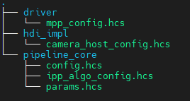

1.以3516开发板为例，3516开发板为OpenHarmony操作系统，其camera驱动为Mpp接口，配置文件放在vendor/hisilicon/Hi3516DV300/hdf\_config/uhdf/camera目录下，后续有芯片产品以Mpp为驱动接口的，可都放在此目录中。

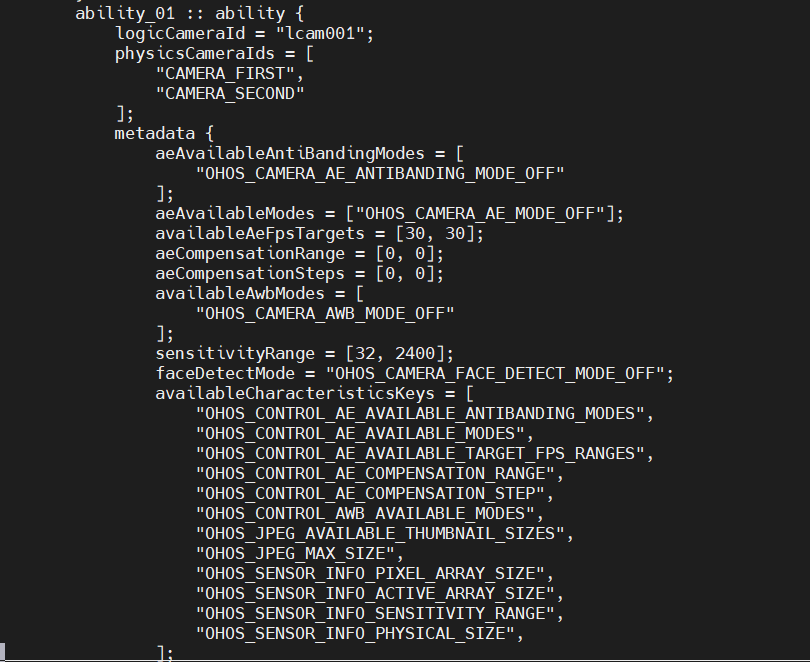

2.HDI\_impl下的camera\_host\_config.hcs为物理/逻辑camera配置、能力配置，此处的物理/逻辑camera配置，需要在hal内部使用，逻辑camera及能力配置需要上报给上层，请按照所适配的芯片产品添加其能力配置。

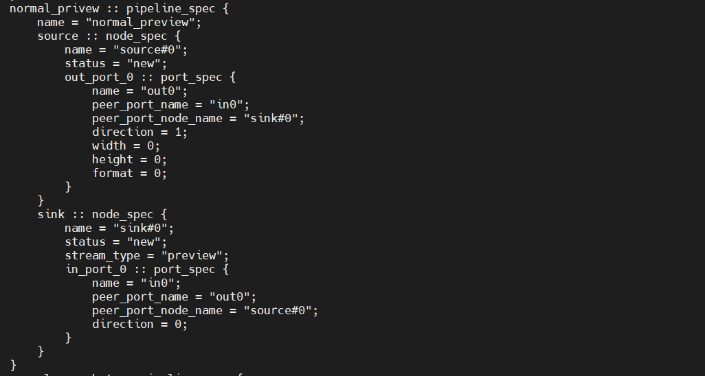

3.pipeline\_core下的config.hcs为pipeline的连接方式，按场景划分每一路流由哪些node组成，其连接方式是怎样的，如上图为preview场景的示例，source和sink为node，source为数据源端，sink为末端，node中的name为node名，status、in/out\_port分别为node状态及输入/输出口的配置，以in\_port\_0为例，name = &quot;in0&quot;代表它的输入为port0，它的对端为source node的out0，direction为它的源node和对端node是否为直连方式。如新添加芯片产品，必须按实际连接方式配置此文件。

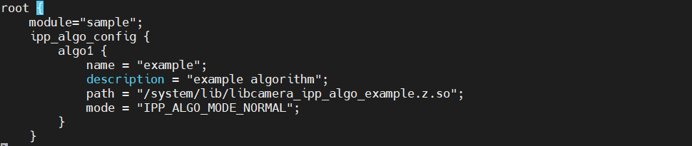

4.ipp\_algo\_config.hcs为算法配置文件，需要描述算法名，以及算法库路径及模式。如无算法加载需求，不需配置此文件。

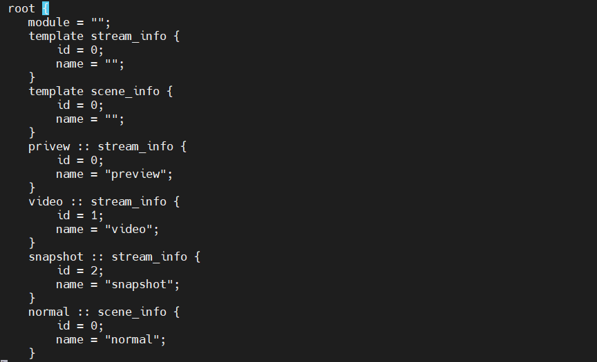

5.param.hcs为场景、流类型名及其id定义，pipeline内部是以流id区分流类型的，所以此处需要添加定义。

## Chipset和platform适配介绍

目录结构如下：

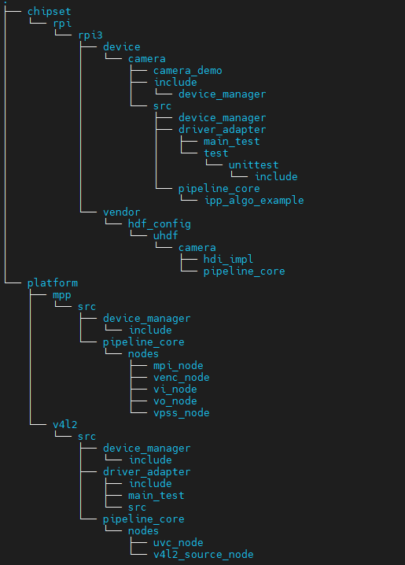

1.platform为平台性公共代码，如linux标准v4l2适配接口定义，chipset为具体某芯片平台相关代码，例如，chipset目录下有hispark\_taurus和rpi4b，分别对应的是hi3516平台和树莓派4b开发板。

2.platform目录下的v4l2包含了src，src中driver\_adapter为linux v4l2标准适配接口，如有定制化功能需求，可继承driver\_adapter，将定制化的具体功能接口放在chipset中实现。如无芯片定制化功能，可直接使用已有的driver\_adapter，具体实现介绍见3.4章节介绍。

3.platform目录下的ipp\_algo\_example为实际的软件处理算法模块，其是被ipp\_node加载执行。如有定制化需求，请放在chipset中实现。算法的调用是通过函数指针进行调用的，需要实现如下接口(定义在pipeline\_core/ipp/include/ipp\_algo.h)：

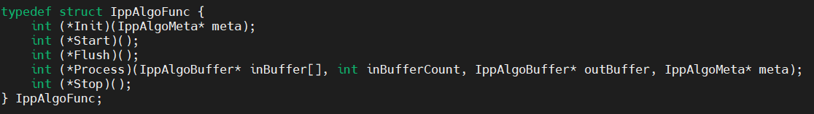

Init接口为算法初始化接口，按需添加实现。

Start为算法内部加载接口，按需添加实现。

Flush为停流前，可进行一些资源释放或其他功能接口，按需添加实现。

Process为算法对帧数据处理功能接口，内部实现，按需添加。

Stop为算法停止、去初始化接口,按需添加实现。

4.platform目录下的nodes为v4l2\_source\_node和uvc\_node(usb热插拔设备，此模块也为linux标准接口，可直接使用)，如下图为v4l2\_source\_node的接口声明头文件。

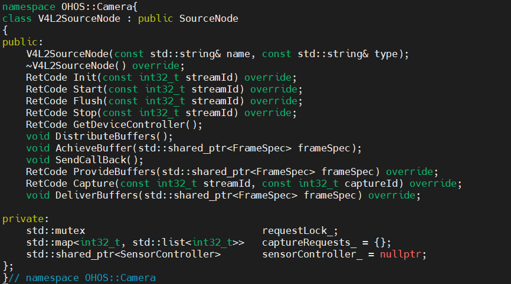

Init接口为模块初始化接口

Start为使能接口，比如start stream功能等。

Stop 为停止接口。

GetDeviceController为获取deviceManager对应的controller接口。

DistributeBuffers为buffer轮转的线程，从底层获取到buffer后，分发到当前node的对端node的接口。

5.chipset目录下的rpi4b包含了include和src，src中devicemanager设备管理目录，主要对接pipeline，实现平台特有的硬件处理接口及数据buffer的下发和上报、metadata的交互。

下图为device\_manager的实现框图，pipeline控制管理各个硬件模块，首先要获取对应设备的manager，通过manager获取其对应的controller，controller和对应的驱动进行交互。

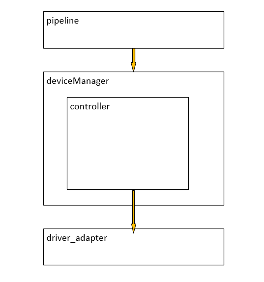

deviceManager中需要实现关键接口介绍：

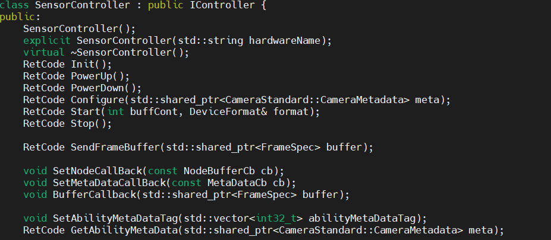

PowerUp为上电接口，OpenCamera时调用此接口进行设备上电操作。

PowerDown为下电接口，CloseCamera时调用此接口进行设备下电操作。

Configure为Metadata下发接口，如需设置metadata参数到硬件设备，可实现此接口进行解析及下发。

Start为硬件模块使能接口，pipeline中的各个node进行使能的时候，会去调用，可根据需要定义实现，比如sensor的起流操作就可放在此处进行实现。

Stop和Start为相反操作，可实现停流操作。

SendFrameBuffer为每一帧buffer下发接口，所有和驱动进行buffer交互的操作，都是通过此接口进行的。

SetNodeCallBack为pipeline通过此接口将buffer回调函数设置到devicemanager。

SetMetaDataCallBack为metadata回调接口，通过此接口将从底层获取的metadata数据上报给上层。

BufferCallback上传每一帧已填充数据buffer的接口，通过此接口将buffer上报给pipeline。

SetAbilityMetaDataTag设置需要从底层获取哪些类型的metadata数据，因为框架支持单独获取某一类型或多类型的硬件设备信息，所以可以通过此接口，获取想要的metadata数据。

其余接口可参考adapter/chipset/rpi4b/src/device\_manager。