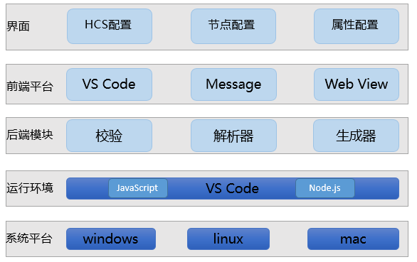
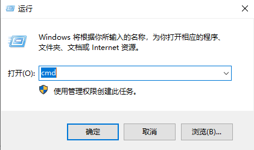
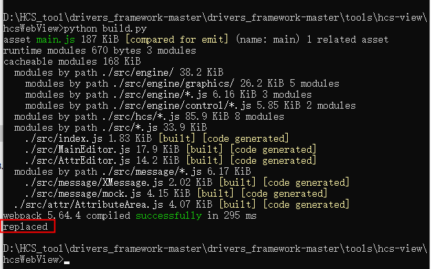
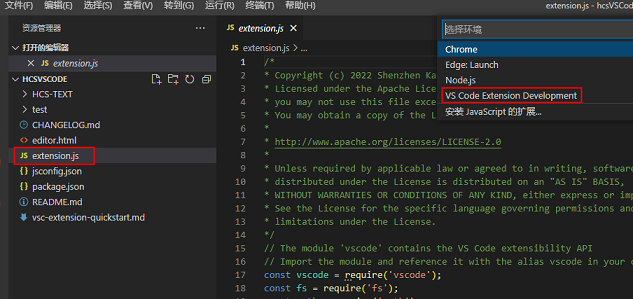
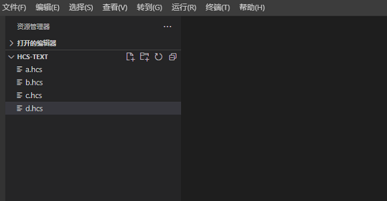
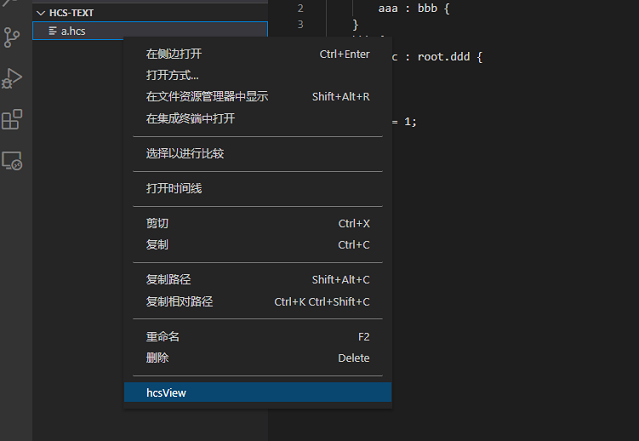
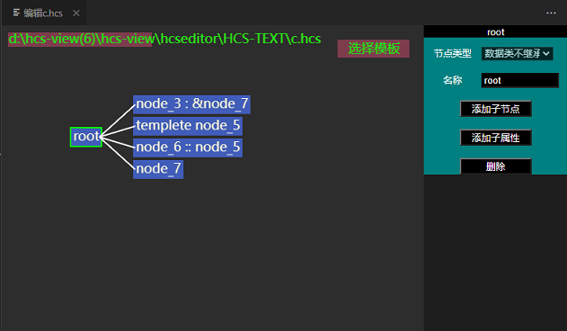
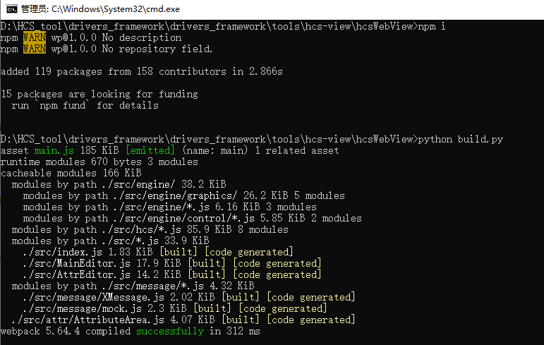
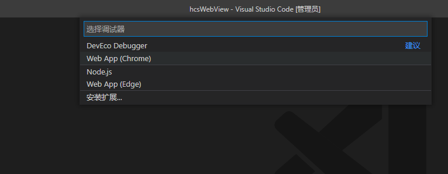
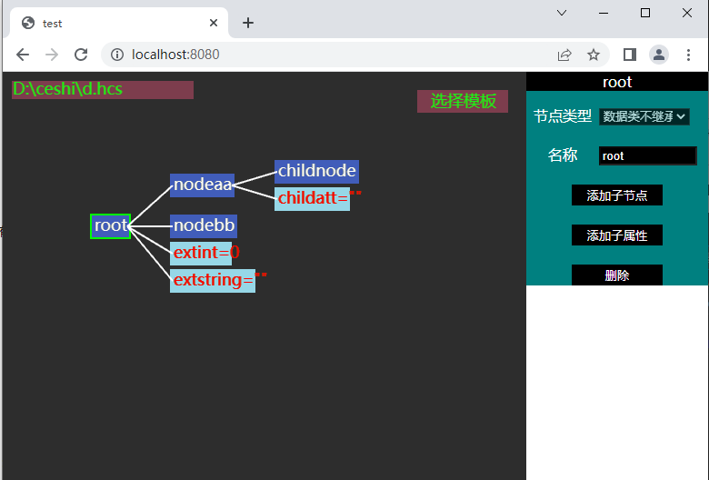

# HCS可视化工具源码使用说明
## 简介

HCS可视化工具支持HCS文件预览与编辑，具有可视化配置与HCS文件内容双向绑定、同步更新展示的优点。
工具文件说明如下：

	├── hcsVSCode                                     # HCS可视化工具         
    │   ├── HCS-TEXT                                  # HCS文件存放地址 
    │   ├── test                                      # 冒烟测试
    │   |   ├── suit  
    │   |   |    ├── extension.test.js                # 图片资源文件
    │   |   |    ├── index.js                         # 图片资源文件
    │   |   ├── runTest.js
    │   ├── README.md                                 # 工具指导文档
    │   ├── editor.html                               # 插件网页版源码
    │   ├── extension.js                              # 插件源码               

## 工具介绍

通过HCS可视化工具，使用者可在HCS-TEXT目录下新增或添加已有的hcs文件，通过编辑hcs文件打开配置节点UI图，进行预览、编辑等操作。HCS可视化工具的软件架构如下：

## VS Code源码使用方法

### 说明
visual studio code 版本需1.62.0及以上。

安装依赖库：
1.右键windows开始菜单，单击运行，输入cmd，单击确定。

2.在命令行中进入到hcsVSCode目录下，安装依赖库，命令如下：

	npm i

3.在命令行中进入到hcsWebView目录下，安装依赖库，命令如下：

	npm i

### 步骤

1.首次使用工具或本地代码有更新时，需运行hcsWebView目录下build.py文件更新本地代码，运行成功后命令行中显示“replaced”，表示代码更新成功，如下图所示：

2.VS Code中，点击文件->打开文件夹，找到hcsVSCode工程所在路径，打开工具代码。然后左侧导航栏选中extension.js文件，按下键盘F5键，选择“VS Code Extension Development”环境运行工程，即可打开编辑hcs文件新窗口，如下图所示：

3.HCS-TEXT列表中选中将要编辑的hcs文件，右键点击“hcsView”，可打开HCS文件对应的可视化配置窗口，便可进行预览或编辑节点等操作。

注意：若新窗口打开文件列表为空或与hcsVSCode路径下HCS-TEXT文件夹内容不一致，可在VS Code中左上角点击文件->打开文件夹，选择正确的HCS-TEXT内容。

## VS Code开发调试指导方法

### 说明
visual studio code 版本需1.62.0及以上。

安装依赖库：
1.右键windows开始菜单，单击运行，输入cmd，单击确定。

2.在命令行中进入到hcsWebView目录下，安装依赖库，命令如下：

	npm i

### 步骤

1.修改启动方式，将hcsWebView目录下build.py文件内容修改为以下代码，其他代码注释掉。

	import os
	os.system("npx webpack --mode=development")

2.命令行进入hcsWebView目录下，运行build.py文件更新本地代码，运行成功后命令行中显示“successfully”，表示代码更新成功，如下图所示：

3.命令行进入hcsWebView目录下，启动8080端口服务，命令如下：

	D:\HCS_tool\drivers_framework\drivers_framework\tools\hcs-view\hcsWebView>python -m http.server 8080
	Serving HTTP on :: port 8080 (http://[::]:8080/) ...

4.VS Code中，点击文件->打开文件夹，找到hcsWebView工程所在路径，打开工具代码。按下键盘F5，选择Chrome，生成launch.json文件。

5.再次按下键盘F5，即可打开mock调试网页，如下图所示：

## 注意
暂无
